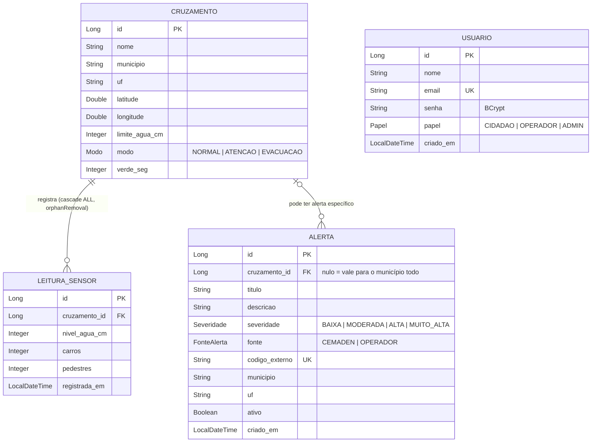

# Semáforo Inteligente API: modo enchente e onda verde de evacuação

Global Solution FIAP 2026/2 (CitizenTech), disciplina **Java Advanced**.

Com o El Niño, o Sul do Brasil tem chuva acima do normal entre novembro e janeiro, e cruzamentos alagados viram armadilha para motoristas e pedestres. A API centraliza o que cada cruzamento "sabe" (nível da água medido pelo sensor ultrassônico, carros e pedestres contados pela câmera) junto com os **alertas oficiais da Defesa Civil/CEMADEN** e decide o modo de cada semáforo:

| Modo | Quando | Comportamento (`verdeSeg`) |
|---|---|---|
| `EVACUACAO` | alerta ativo **ALTA** ou **MUITO_ALTA** no município ou no cruzamento | onda verde: 90 s para esvaziar a área |
| `ATENCAO` | água ≥ limite do cruzamento **ou** alerta **MODERADA** | amarelo piscante: 0 s |
| `NORMAL` | nenhum dos casos acima | 30 s + 2 s por pedestre esperando (máx. 60 s), travessia mais acessível |

O dispositivo (Arduino UNO + gateway Python) consulta `GET /cruzamentos/{id}/modo` e envia `POST /cruzamentos/{id}/leituras`. O app Mobile (Flutter) consome a mesma API para mostrar alertas e o estado dos cruzamentos.

## Integrantes

| Nome | RM |
|---|---|
| Ruan Lima da Silva | 566719 |
| Julia Valerio Guimarães da Silva | 568275 |
| Rhayssa Graziano Bernardes e Rocha Ferreira | 567549 |

Turma: 2TDSPR

**Vídeo pitch:** _link a preencher_

## Tecnologias

Java 21, Spring Boot 3.5 (Web, Data JPA, Validation, Security, Cache, HATEOAS, Actuator), JJWT 0.12, springdoc-openapi 2.8 (Swagger UI), H2 (dev) e PostgreSQL 16 (Docker).

## Como rodar

### Local (H2 em memória, sem instalar nada além do JDK 21)

```bash
./mvnw spring-boot:run
```

A API sobe em `http://localhost:8080` com dados de exemplo (cruzamentos em Porto Alegre, Canoas e Lajeado, além de um alerta ALTA em Lajeado).

- Swagger UI: http://localhost:8080/swagger-ui.html (use `/auth/login` e cole o token em **Authorize**)
- Health: http://localhost:8080/actuator/health

Sem `JWT_SECRET` definido, a API gera uma chave aleatória a cada inicialização (os tokens deixam de valer após reiniciar). Para desligar a sincronização com o CEMADEN numa demo offline, use `CEMADEN_ENABLED=false`.

### Docker (API + PostgreSQL)

```bash
cp .env.example .env    # troque DB_PASSWORD e JWT_SECRET
docker compose up -d --build
```

A API fica em `http://localhost:8080` e o Postgres persiste no volume `semaforo-db`.

### Testes

```bash
./mvnw test
```

## Usuários de teste por papel

Criados automaticamente no primeiro start (senha de demonstração, alterável por `APP_SENHA_DEMO`):

| Papel | E-mail | Senha | Pode |
|---|---|---|---|
| ADMIN | `admin@semaforo.dev` | `Semaforo@2026` | tudo, incluindo excluir, gerenciar usuários, `/actuator/metrics` e `/actuator/caches`, e forçar a sincronização com o CEMADEN |
| OPERADOR | `operador@semaforo.dev` | `Semaforo@2026` | cadastrar e editar cruzamentos, registrar leituras (conta usada pelo gateway), criar, editar e encerrar alertas |
| CIDADAO | `cidadao@semaforo.dev` | `Semaforo@2026` | consultar cruzamentos, leituras e alertas |

`POST /auth/cadastro` é público e sempre cria **CIDADAO**. Só um ADMIN promove alguém (`PATCH /usuarios/{id}/papel`).

## Endpoints

| Método | Rota | Acesso | Descrição |
|---|---|---|---|
| POST | `/auth/cadastro` | público | cria cidadão (201) |
| POST | `/auth/login` | público | devolve o JWT |
| GET | `/cruzamentos?modo=&page=&size=&sort=` | autenticado | lista paginada e ordenável, com filtro por modo |
| GET | `/cruzamentos/em-risco?horas=24` | autenticado | cruzamentos com água acima do limite no período |
| GET | `/cruzamentos/{id}` | autenticado | detalhe com links HATEOAS |
| POST / PUT | `/cruzamentos`, `/cruzamentos/{id}` | OPERADOR, ADMIN | cria (201 + `Location`) ou atualiza |
| DELETE | `/cruzamentos/{id}` | ADMIN | 204 |
| GET | `/cruzamentos/{id}/modo` | **público** | `{"modo":"NORMAL","verdeSeg":30}` para o dispositivo |
| POST | `/cruzamentos/{id}/leituras` | OPERADOR, ADMIN | `{"nivelAguaCm":42,"carros":7,"pedestres":3}` (201), recalcula o modo |
| GET | `/cruzamentos/{id}/leituras` | autenticado | histórico paginado |
| GET | `/alertas?severidade=&fonte=&ativo=&municipio=&uf=&desde=&cruzamentoId=` | autenticado | filtros dinâmicos |
| GET | `/alertas/{id}` | autenticado | detalhe |
| POST / PUT | `/alertas`, `/alertas/{id}` | OPERADOR, ADMIN | alerta manual (plano B da Defesa Civil); alertas vindos do CEMADEN não são editáveis |
| PATCH | `/alertas/{id}/encerrar` | OPERADOR, ADMIN | encerra o alerta e recalcula os cruzamentos |
| DELETE | `/alertas/{id}` | ADMIN | 204 |
| POST | `/alertas/cemaden/sincronizar` | ADMIN | força a sincronização agora |
| GET / PATCH | `/usuarios`, `/usuarios/{id}/papel` | ADMIN | gestão de papéis |
| GET | `/actuator/health`, `/actuator/info` | público | saúde e informações |
| GET | `/actuator/metrics`, `/actuator/caches` | ADMIN | métricas e caches |

Erros seguem um formato único (`@RestControllerAdvice` e handlers do Spring Security):

```json
{"timestamp":"...","status":400,"erro":"Bad Request","mensagem":"Dados inválidos","caminho":"/cruzamentos","campos":{"uf":"o tamanho deve ser entre 2 e 2"}}
```

400 = validação ou parâmetro inválido (inclusive `sort` por campo inexistente), 401 = sem token ou login errado, 403 = papel insuficiente, 404 = id ou rota inexistente, 405 = método não suportado na rota, 409 = violação de integridade, 415 = Content-Type diferente de JSON, 422 = regra de negócio (e-mail duplicado, editar alerta do CEMADEN), 500 = erro inesperado (logado, sem detalhes internos na resposta).

## Diagrama das entidades



### Como os relacionamentos foram modelados

- **Cruzamento 1:N LeituraSensor**: a leitura não existe sem o cruzamento. Por isso o lado `@OneToMany` usa `cascade = ALL` e `orphanRemoval = true` (excluir o cruzamento apaga o histórico do sensor). O lado `@ManyToOne` é `LAZY` e obrigatório.
- **Cruzamento 1:N Alerta (opcional)**: o alerta tem vida própria (normalmente vem do CEMADEN para um município inteiro), então **não há cascade**. Ao excluir um cruzamento, os alertas são desvinculados (`update ... set cruzamento = null`) em vez de apagados. `cruzamento_id` nulo significa que o alerta vale para todos os cruzamentos do município.
- Todos os `@ManyToOne` são `LAZY` e `spring.jpa.open-in-view=false`: o mapeamento para DTO acontece dentro da transação do service, então nenhuma entidade sai para o JSON (sem N+1 escondido nem `LazyInitializationException`).
- `modo` e `verdeSeg` ficam **persistidos** no cruzamento e são recalculados a cada leitura ou mudança de alerta. Assim a consulta do dispositivo é uma leitura simples e dá para filtrar por modo no banco.

## Justificativa das consultas

| Consulta | Tipo | Por quê |
|---|---|---|
| `findByModo(modo, pageable)` | query method derivado | filtro fixo de igualdade; o nome do método já descreve a consulta e o Spring Data gera paginação e ordenação |
| `findFirstByCruzamentoIdOrderByRegistradaEmDescIdDesc` | query method derivado | "última leitura" com `LIMIT 1`, usada a cada recálculo de modo |
| `findByMunicipioIgnoreCaseAndUfIgnoreCase` / `findByFonteAndAtivoTrue` / `existsByCodigoExterno` | query method derivado | buscas simples da sincronização com o CEMADEN; `exists` evita carregar a entidade só para checar duplicidade |
| `findComAguaAcimaDoLimiteDesde(desde)` | `@Query` JPQL | compara a leitura com o limite **do próprio cruzamento** (coluna × coluna) dentro de um `exists`, o que não é expressável por nome de método |
| `findAtivosDoCruzamento(id, municipio, uf)` | `@Query` JPQL | junta dois critérios com `OR` (alerta do cruzamento **ou** alerta municipal sem cruzamento) usando `left join`; por nome de método ficaria ilegível e errado com nulos |
| `desvincularDoCruzamento(id)` | `@Query` + `@Modifying` | um `UPDATE` em lote ao excluir cruzamento, sem carregar cada alerta |
| `AlertaSpecifications.com(filtro)` | **Specification** | o app combina livremente severidade, fonte, ativo, município (parcial), UF, data e cruzamento; com Specification só os filtros informados entram no `WHERE`, sem 2⁷ métodos diferentes |

## Justificativa do cache

| Cache | Método | Por quê | Invalidação |
|---|---|---|---|
| `modoCruzamento` | `CruzamentoService.modo(id)` | consulta mais frequente do sistema: cada semáforo pergunta o modo a cada ciclo, e o resultado só muda quando chega leitura ou alerta | `@CacheEvict(allEntries = true)` em criar, atualizar e excluir cruzamento, registrar leitura, criar, atualizar, encerrar e excluir alerta, e na sincronização do CEMADEN |
| `cruzamento` | `CruzamentoService.buscar(id)` | o app abre o detalhe do cruzamento ao tocar no mapa; dado lido muitas vezes e alterado pouco | mesmas operações acima |

A invalidação é `allEntries` porque **um único alerta municipal muda o modo de vários cruzamentos** de uma vez; evitar por chave deixaria cruzamentos com modo velho. Listas paginadas e alertas não são cacheados: mudam a cada sincronização e têm combinações demais de filtros e páginas. O provedor é o `ConcurrentMapCache` padrão (uma instância só). Com várias réplicas, o certo seria trocar por Redis.

## HATEOAS

Os recursos principais (`cruzamento`, `alerta`, `leitura`) devolvem `_links` no formato HAL, e as listas trazem `first/prev/next/last` e `page`. As **ações aparecem conforme o papel** do token: CIDADAO vê `self`, `modo`, `leituras`, `alertas` e `cruzamentos`; OPERADOR também vê `atualizar`, `registrar-leitura` e `encerrar` (este só se o alerta estiver ativo); ADMIN também vê `excluir`.

## Segurança (fluxo JWT)

1. `POST /auth/login` → o `AuthenticationManager` confere a senha com **BCrypt** → `JwtService` assina um HS256 com `sub = e-mail`, `papel`, `iss`, `iat` e `exp` (8 h).
2. Nas requisições seguintes, o `JwtAuthFilter` lê `Authorization: Bearer ...`, valida assinatura, emissor e expiração e **recarrega o usuário do banco**, então rebaixar um papel vale na hora.
3. O `SecurityFilterChain` aplica as regras por método e rota (tabela acima). A API é stateless, sem sessão e sem CSRF, porque não usa cookie.
4. O CORS é liberado para o app Mobile (`CORS_ORIGINS`, padrão `*`).

O segredo do JWT e a senha do banco vêm apenas de variáveis de ambiente (`.env` está no `.gitignore`).

## Integração CEMADEN

`CemadenScheduler` roda a cada 5 min (`CEMADEN_INTERVALO`) e consulta `https://painelalertas.cemaden.gov.br/wsAlertas2`. Ele importa só os alertas ativos de **municípios que têm cruzamento cadastrado**, sem duplicar (usa `codigo_externo`), e encerra os que saíram do painel. Depois recalcula o modo dos cruzamentos afetados (nível Alto ou Muito Alto leva a `EVACUACAO`). Uma falha na fonte externa só gera log e não derruba a API. Se o endpoint (não documentado oficialmente) mudar, o plano B é o operador registrar o alerta em `POST /alertas`.

## Uso de IA generativa

| Ferramenta | Para quê |
|---|---|
| Claude / LLMs | Apoio no desenho da arquitetura, estruturação e geração inicial do código-fonte, escrita de testes automatizados, documentação e revisão dos requisitos da GS |

Todo código gerado com apoio de IA foi revisado, testado (`./mvnw test`), ajustado e compreendido pelo grupo antes do commit.
